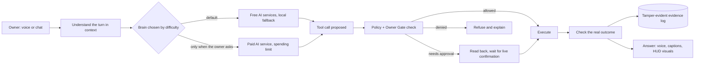

# Architecture (high level)

[← Back to overview](../README.md)

CIPHER is organized as **one platform, three capability domains and one security and governance control plane**. This page shows the shape of the system only; internal interfaces, rules and tuning are private.

## Layers

| Layer | Role |
|---|---|
| **Identity** | CIPHER: one persistent identity across model switches, provider failures and restarts |
| **Intelligence Platform** | Shared services: conversation, voice, memory, model and provider routing, knowledge, tools, visual interaction, embodiment, scheduling |
| **Three capability domains** | Cybersecurity Intelligence, Human Empowerment, Resilience |
| **Security & Governance Control Plane** | The 14 controls ([Security first](security-first.md)) applied across the whole platform |
| **Extensions** | Models, tools, connectors and devices (e.g. Ciphlet) that extend CIPHER without redefining it |

## Design decisions

- **Understand first, then act.** The brain reads the whole turn in context and chooses actions through tool use. Keywords are only hints; they are decisive only for instant controls such as stop, mute, standby and emergency stop.
- **Honest about its brain.** CIPHER says which AI service it is using, says when it is degraded, and says when a request is beyond the free service.
- **Local where it matters.** Speech recognition, speech synthesis, image generation and the evidence log run on the Mac.
- **Presence.** A desktop embodiment and a holographic HUD show CIPHER's state and teaching visuals; visuals never cover his face and always close by voice or click.
