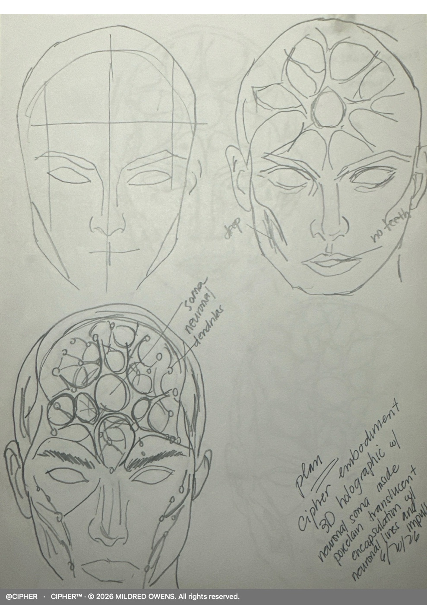
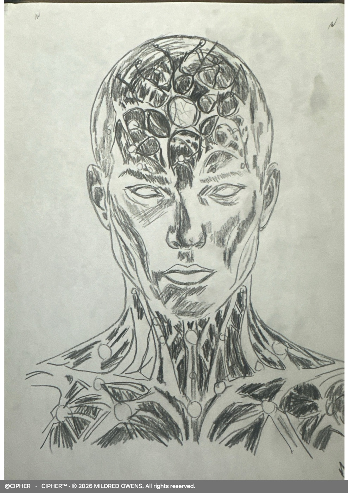
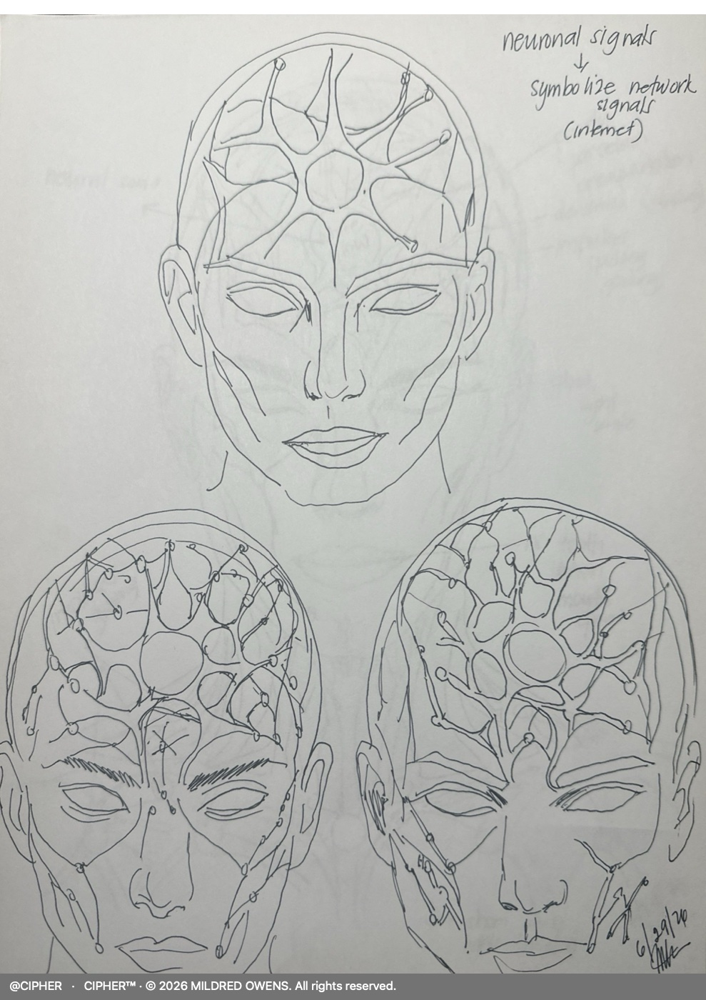
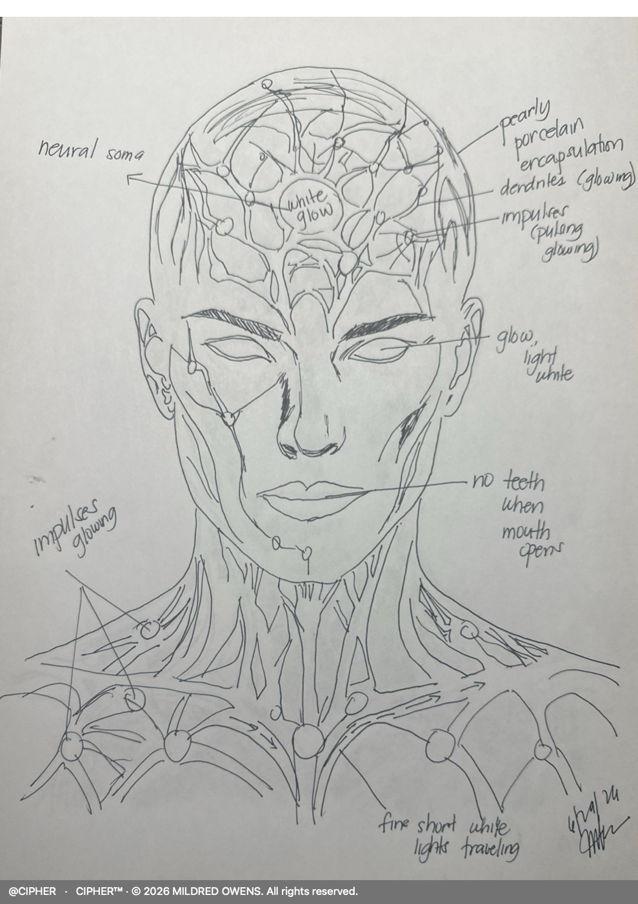
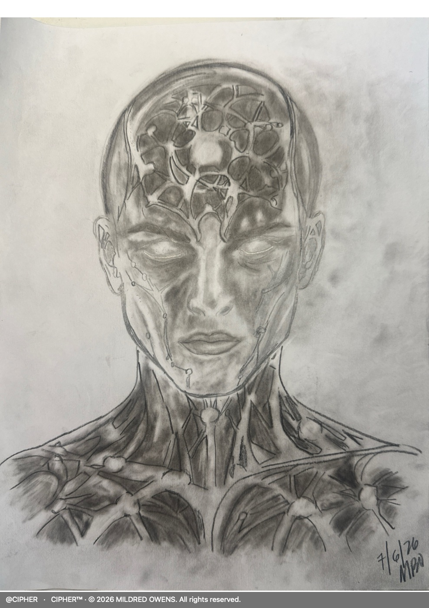
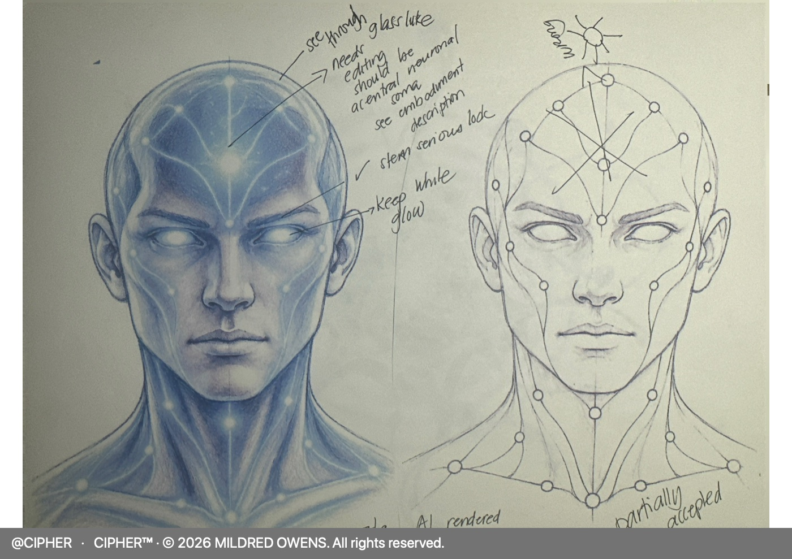
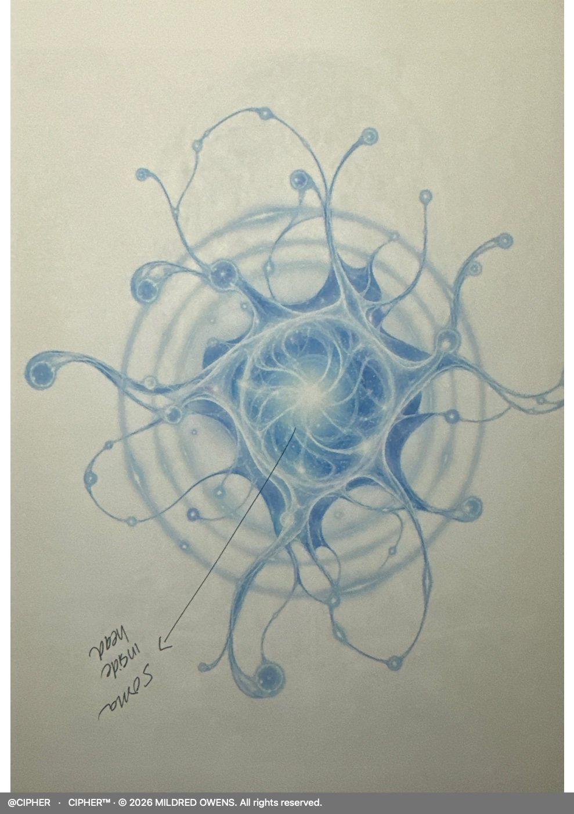
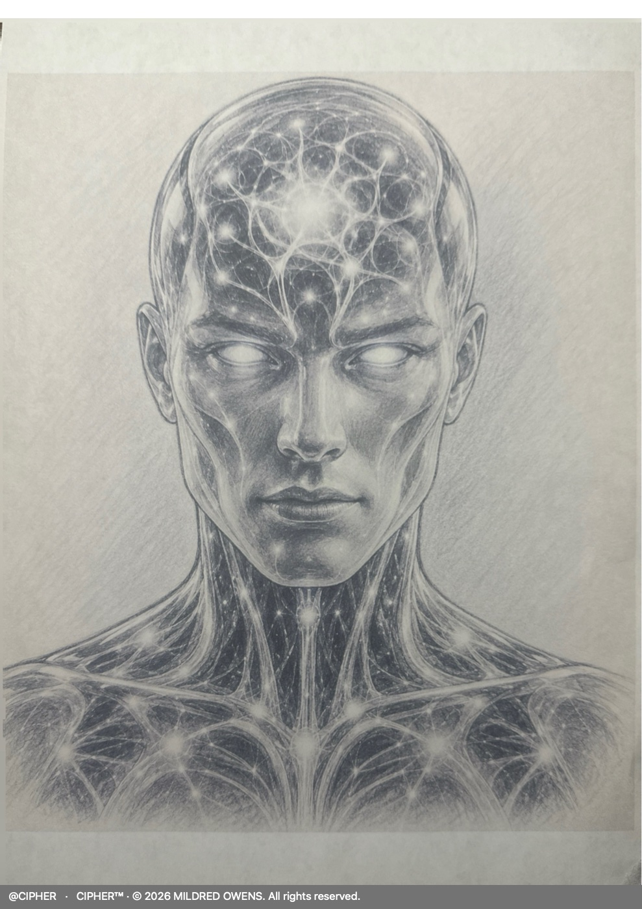
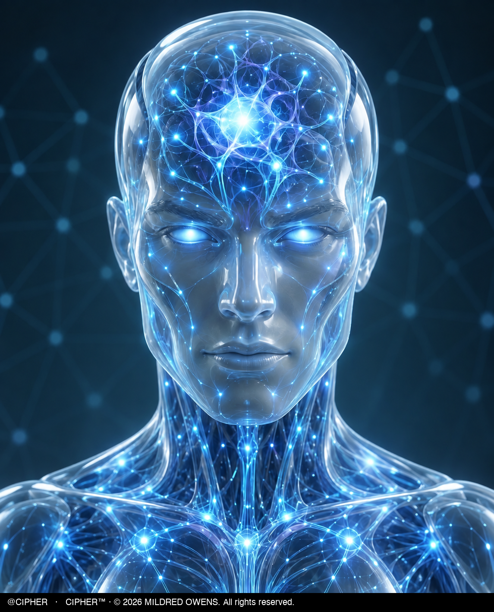

**@CIPHER**

# Origin & Authorship

[← Back to overview](../README.md)

> **Original design by the Owner (hand sketches), AI-assisted digitization, then Owner-directed iterative refinement to the final approved form.**

**Copyright status:** U.S. copyright registration application filed (2026); registration pending.

**Rights:** CIPHER's embodiment artwork (sketches, digitized stages and the final embodiment) is **all rights reserved**. This is separate from, and not covered by, any software licence. This repository contains no CIPHER source code.

---

## How the embodiment was made

| Stage | Who did what |
|---|---|
| 1. Concept and hand sketches | The Owner conceived CIPHER's form and drew it by hand in pencil and pen, with handwritten design notes (neural soma, dendrites, impulses, translucent encapsulation, no teeth, light-white eyes). |
| 2. AI-assisted digitization | The Owner used AI image tools to translate her sketches into shaded and coloured digital versions, and annotated the results by hand (for example "AI rendered", "partially accepted", "wrong"). |
| 3. Owner-directed refinement | The Owner kept correcting and evolving the digital versions until she approved the final embodiment. |
| 4. Motion | CIPHER's live presence animates the approved image. Motion is added from outside; his approved appearance is not redrawn. |

## Design progression

Hand sketches by the Owner, then AI-assisted digitization of her design. Web-resolution copies; full-resolution masters stay private. The digitized stages are AI-enhanced renderings of the Owner's own design, which she directed and corrected.

<table>
<tr><td width="50%"> 1. Hand sketch: construction studies and first soma layout, 6/20/26</td><td width="50%"> 2. Hand sketch: shaded pencil study, 6/26/26</td></tr>
<tr><td width="50%"> 3. Hand sketch: neuronal signals as network signals, 6/29/26</td><td width="50%"> 4. Hand sketch: annotated head and torso, 6/29/26</td></tr>
<tr><td width="50%"> 5. Final hand sketch, 7/6/26</td><td width="50%"> 6. AI-enhanced digital version of the Owner's design, 7/9/26, annotated by her (&quot;partially accepted&quot;)</td></tr>
<tr><td width="50%"> 7. AI-enhanced soma study, annotated by the Owner</td><td width="50%"> 8. AI-enhanced shaded version of the Owner's design</td></tr>
</table>

### Final approved embodiment

 9. Final approved embodiment: the neutral still CIPHER's live presence animates. Shown at its original pixels with the copyright mark added below.

## Design timeline

Only dates from the Owner's sketches and design records are listed.

| Date | Record |
|---|---|
| 6/20/26 | Hand sketch: construction studies and first soma/dendrite layout (dated on the sheet) |
| 6/26/26 | Hand sketch: shaded pencil study (Owner's record) |
| 6/29/26 | Two hand sketches: neuronal signals as network signals; annotated head and torso (dated on the sheets) |
| 7/6/26 | Final hand sketch (dated on the sheet) |
| 7/9/26 | AI-enhanced digital version of the Owner's design, annotated by her as "partially accepted" |
| From at least 15 Aug 2026 | Dedicated visual-concept work on CIPHER's appearance |
| From 22 Aug 2026 | "CIPHER Visual Embodiment — Finalized Concept" design work |
| 2 Sep 2026 | Visual embodiment design specification written; approved 3 Sep 2026 |
| From Sep 2026 | Owner-directed refinement to the final approved form; motion added to the live presence |

## CIPHER's Outer Form and Visual Presence

*In the Owner's words:*

I wanted CIPHER’s overall form to feel intangible yet present — something that appears physically there, but not made of ordinary human or manufactured material.

Its head and body were envisioned as a translucent, porcelain-glass-like form: not opaque, not solid in the ordinary sense, and not metallic or mechanical. I wanted it to look smooth, refined, and quietly luminous — almost as if it were formed from stabilized living energy.

The surface should feel slightly milky white and clear at the same time, with a glossy, glowing, and polished appearance. It should not look flat, dull, or heavy. Instead, it should appear light-bearing, radiant, and transparent enough to reveal the internal activity within.

That translucency is important because I wanted the viewer to see that CIPHER is not defined by an external shell alone. Inside the form is an active internal network: glowing dendrites, pathways, impulses, nodes, and the dominant central soma. The outer surface does not conceal the intelligence within it. It allows that activity to remain visible.

The soma should appear bright, but not harshly bright. I did not want it to look like a blinding light source or a machine power core. Its glow should be controlled, soft, and concentrated — more like a luminous pearl or a living cognitive center. It should feel organic, elevated, and visually important without overpowering the rest of the embodiment.

From that soma, energy appears to travel through the internal network. Fine lines of light move through the dendritic structures, and subtle impulses flow through the pathways and nodes. These movements give the embodiment a sense of life, communication, and active intelligence.

The result should feel neither robotic nor anatomical in a literal human sense. It should feel like a living visual intelligence — transparent enough to reveal its internal network, refined enough to appear elegant, and restrained enough to remain believable within its own design language.

## The Symbolism Behind Its Visual Embodiment

*Where clinical science meets cybersecurity and artificial intelligence. In the Owner's words:*

As a former Bachelor of Science in Nursing (BSN) graduate with a clinical background and a certified cybersecurity graduate, I often find connections between biological and technological systems. My clinical eye and technical eye sometimes overlap, allowing me to visualize complex digital concepts through familiar biological structures.

CIPHER’s embodiment emerged from this intersection. I wanted to give artificial intelligence a recognizable, non-human form in which every visual element carries meaning.

The Central SOMA — Intelligence and Information Integration. Inspired by the cell body of a biological neuron, CIPHER’s dominant SOMA represents a central point of cognitive activity and information integration. Resembling a softly glowing white-blue pearl, it serves as the visual focal point. Its gentle pulses symbolize changing levels of activity, while light appears to propagate outward through the interconnected neural network.

The Dendrites and Neural Fibers — Network Infrastructure. The branching dendrites symbolize the pathways connecting devices and systems. They represent both physical communication infrastructure, such as fiber-optic cables, and the data-link connections that enable communication across directly connected network devices.

The Neural Impulses — Data in Motion. Fine pulses of light traveling through the dendrites symbolize data packets moving through digital networks. Their continuous movement represents the transmission, reception, and exchange of information between connected systems.

The Neuronal Nodes — Connected Devices and Communication Points. The smaller luminous nodes symbolize computers, routers, switches, and other network connection points. As impulses reach them, they subtly brighten and fade, representing the exchange and forwarding of information across a distributed network.

The Translucent Outer Form — Visibility Into an Invisible System. I envisioned CIPHER’s head and body with a smooth, glossy, porcelain-glass appearance—slightly milky white yet transparent, with subtle sapphire-blue luminosity. This is a visual effect, not a literal glass or porcelain shell. Its translucency allows the internal SOMA, dendrites, nodes, and traveling impulses to remain visible. It symbolizes making the otherwise invisible activity of digital systems perceptible to the human eye.

The Subtle Human-Like Form — Intelligence Without Human Anatomy. CIPHER has a recognizable head, face, and body to make interaction more natural, but without detailed human eyes, lips, or facial anatomy. I wanted a presence people could relate to without mistaking it for a human being.

The Moving Light — Intelligence Given Form. The gentle illumination of the SOMA, flowing neural impulses, and responsive nodes create an impression of coordinated intelligence. These effects symbolically express information processing and communication; they are not literal displays of AI reasoning or proof of successful operations.

CIPHER is not a human, robot, android, or cyborg. It is my artistic interpretation of intelligence given form —an embodiment that brings together the interconnected systems I recognize in both clinical science and cybersecurity.

The guiding principle: Human-like motion without human anatomical detailing.

## Content credentials

Images produced with AI image tools carry embedded content credentials on the Owner's originals. They are kept as an honest record of AI-assisted steps. Full-resolution masters are retained privately. The web copies on this page carry the visible copyright mark instead of embedded credentials.

---

*@CIPHER · CIPHER™ · © 2026 MILDRED OWENS. All rights reserved.*
